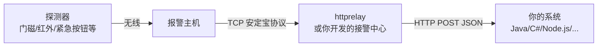

# ademco_hb — 安定宝协议恒博实现

安定宝（Ademco）报警协议的恒博（HB）实现：报警主机与接警中心之间通信协议的开源 `C` 库、多语言绑定与 `HTTP` 转发器。目标是让报警设备接入你的系统尽可能简单——多数场景下，你只需开发一个 `HTTP` 接口。

## 快速分流：30 秒找到你的路线

| 你的需求 | 推荐路线 | 需要开发什么 | 先读 |
| ---- | ---- | ---- | ---- |
| 收报警/布撤防等事件，远程布撤防 | **httprelay（推荐）** | 一个 `HTTP` 接口（如 Spring Boot Controller） | [快速上手](docs/快速上手.md) → [对接说明](docs/对接说明.md) |
| 完整协议直连（防区表下载、定时器管理等） | `TCP SERVER` 直连 | 自行开发（可用绑定省去协议解析） | [协议文档](docs/README.md) + [swig 绑定](swig/README.md) |
| 研究协议本身 | — | — | [协议文档](docs/README.md) |

`httprelay` 接收主机 `TCP` 连接，将事件以 `JSON POST` 转发到你的服务器（`1946`/`1944` 在线掉线、全部报警与状态事件），并内置远程布撤防控制接口（`POST /control`，token 鉴权）。Java/C#/Node.js 用户**无需写一行协议代码**。

## 仓库结构

| 目录 | 内容 |
| ---- | ---- |
| `src/libademco` | 核心：协议解析/打包库（事件码、帧结构、`CRC`、`xdata`），`C/C++` 直接使用 |
| `src/libhb` 等 | 主机状态、主机类型、防区属性等定义与接口 |
| `examples/httprelay` | 上述 `HTTP` 转发器（含远程控制），`C/C++` 源码 |
| `examples/server_demo` | `C++` 简易接警中心示例（收事件 + 布撤防） |
| `swig/` | Java / C# / Node.js 语言绑定 |
| `docs/` | 对接说明、协议文档、二次开发指南 |
| `tools/` | 维护者构建/发版脚本 |

## 文档

- [快速上手](docs/快速上手.md)——**第一次接入从这里开始**：15 分钟从零跑通（无需真机）
- [对接说明](docs/对接说明.md)——第三方接入主文档：httprelay 部署、回调接口规格、远程控制、事件码速查、`FAQ`
- [协议文档](docs/README.md)——帧格式、`ACK`/重传机制、事件码全集、主机类型、恒博扩展
- [二次开发](docs/二次开发.md)——编译环境、模拟器联调、抓包分析

## 版本与发布

项目采用分层版本号：整体版本（`ademco_hb`）与各组件版本（`libademco`、`httprelay` 等）独立演进，变更记录见根目录 [CHANGELOG.md](CHANGELOG.md)。

**测试及演示工具（主机模拟器、`AdemcoParser` 等）、各平台预编译绑定与 `httprelay`**，请从 [releases](https://github.com/captainwong/ademco_hb/releases) 下载——优先使用预编译包，无需自行编译。

## 支持与交流

- 对接遇到问题？先查[对接说明 `FAQ`](docs/对接说明.md#11-常见问题faq)，多数高频问题已有答案
- 欢迎提 `issue` 及 `PR`
- QQ 群：`1093730796`

## License

见 [LICENSE](LICENSE)。
