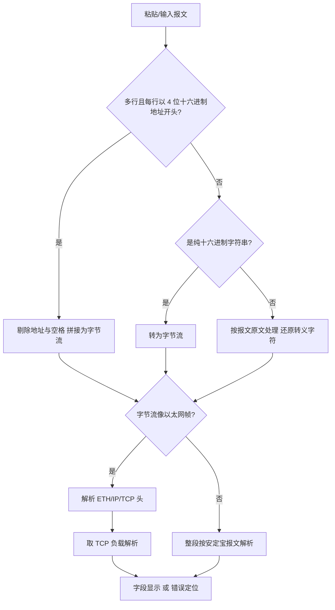

# AdemcoParser 报文解析器使用说明

AdemcoParser 是**离线**的协议报文分析工具：把一段报文粘贴进输入框，各字段即刻被逐项解析展示，不需要连接任何设备。它基于与 `libademco` 库完全相同的解析代码实现，工具显示的结果就是你的对接程序将得到的解析结果，可以放心作为对照基准。

适用读者：接警中心/平台开发人员、现场调试人员、协议学习者。

## 一、快速两步

1. 双击运行 `AdemcoParser.exe`，把报文粘贴进顶部的大输入框；
2. 下方各字段框**实时**显示解析结果（边输入边解析，没有「解析」按钮）；解析失败时，中间的 `pkt` 框会显示错误定位信息（见第四章）。

解析流程如下，输入格式可被自动识别，无需手工指定：



## 二、三种可识别的输入格式

### 1. 十六进制转储（多行）

每行以 **4 位十六进制地址 + 空格**开头，工具自动剔除地址和空格后拼接为字节流，例如主机心跳包的原始字节：

```
0000  0A 39 33 42 33 30 30 33 31 22 4E 55 4C 4C 22 30
0010  30 30 30 52 31 32 33 34 4C 36 37 38 39 23 30 30
0020  30 30 30 30 5B 5D 5F 31 37 3A 32 34 3A 31 34 2C
0030  31 32 2D 30 39 2D 32 30 31 35 0D
```

粘贴后 `id` 框显示 `NULL`（心跳包）、`acct`、`aid`、`time` 等字段依次填充。

若字节流开头是完整的以太网帧（含 `MAC` 头，总长超过 54 字节），工具会自动解析出 `IP` / `TCP` 头部：`From` / `To` 显示来源与目的 `IP` 及端口，`Len` 显示 `TCP` 负载长度，然后只对 `TCP` 负载做协议解析。

### 2. 连续十六进制字符串（单行）

如 `0A39334233303033...`。注意：**不能含空格**——含空格的单行输入会被当作报文原文处理。带空格的十六进制请改用上面的多行转储格式（行首补 `0000 ` 即可）。

### 3. 报文原文

直接粘贴协议文档中的报文样例，如：

```
"\n93B30031\"NULL\"0000R1234L6789#000000[]\_17:24:14,12-09-2015\r"
```

其中 `\n`、`\r`、`\"` 会被按转义字符还原为实际字节，再走解析流程。

## 三、界面分区

### 1. 输入区（顶部）

- 大输入框（带 `00~0F` 列标，方便对位十六进制转储）；
- 「Open dump file」按钮：打开 `*.dmp` / `*.dump` 文件，内容以十六进制转储显示在输入框中并解析；
- 每次输入变化自动重新解析。

### 2. 解析结果区

- `pkt` 框：还原的报文内容（可打印字符直接显示，不可打印字节以十六进制显示）；解析失败时改为显示错误定位信息；
- `From` / `To` / `Len`：链路层信息，仅当输入包含完整以太网帧时填充；
- 字段框（Ademco 层）：

| 字段 | 含义 |
| ---- | ---- |
| `crc` / `len` | 包校验与长度（`len` 同时给出十六进制与十进制） |
| `id` | 报文类型：`ADM-CID` / `HENG-BO` / `NULL`（心跳）/ `ACK` 等 |
| `seq` | 序号，心跳与事件共用递增计数 |
| `acct` | 主机账号 |
| `aid` | 安定宝 `ID`（十六进制显示） |
| `event` | 事件码（如 `1130` 警情、`1400` 布撤防） |
| `gg` / `zone` | 区段号 / 防区号 |
| `xdat` | `xdata` 附加数据原始内容 |
| `time` | 包内时间戳 |

各字段的协议含义详见[协议文档](README.md)。

## 四、解析失败时看什么

解析不通过时，`pkt` 框显示形如：

```
file:xxx.c line:123 offset:37 0025 msg: xxx
```

其中 `offset`（十进制与十六进制各一份）指出解析停在输入字节流的**第几个字节**。典型用法：你的程序解析某段报文失败时，把同一段报文粘进本工具——若工具也失败，看 `offset` 定位问题字节（常见如长度不符、转义未还原、粘贴时丢字节）；若工具成功而你的程序失败，则是你自己的实现与库有分歧。

## 五、典型使用场景

1. **核对主机到底发了什么**：现场用 `Wireshark` 抓包，复制帧字节（十六进制）粘贴进来，逐字段核对（先抓 `TCP` 负载对照 `event` / `zone`，再查收不到事件的原因）；
2. **学习协议**：把[协议文档](README.md)中的报文样例逐个粘贴，对照字段框理解报文结构，比看文档描述直观得多；
3. **排查解析失败**：用错误 `offset` 定位问题字节，用 `crc` 字段核对校验实现；
4. **验证自己的解析实现**：同一份报文，你的解析结果应与本工具完全一致；
5. **分析 dump 文件**：「Open dump file」直接解析主机导出的 `dmp` / `dump` 文件。

## 六、注意事项

- 工具本身不抓包，报文字节需先用 `Wireshark` 等工具获得；从 `Wireshark` 复制时选「字节 + 十六进制」类拷贝格式粘贴即可；
- 单行十六进制输入不能含空格（会被当作报文原文），带空格请用多行转储格式（每行以 `0000 ` 这类地址开头）；
- 输入超过协议最大包长时不会解析，请只粘贴单个报文；
- `xdat` 旁的竖长显示框为预留区域，当前版本不填充内容，请以 `xdat` 单行框为准；
- `32` 位静态链接的单文件程序，无需安装、不联网；examples.zip 的 `x86` 目录内附带即为本工具；
- 窗口标题栏显示「using libhb x.x.x」为所用协议栈版本。
