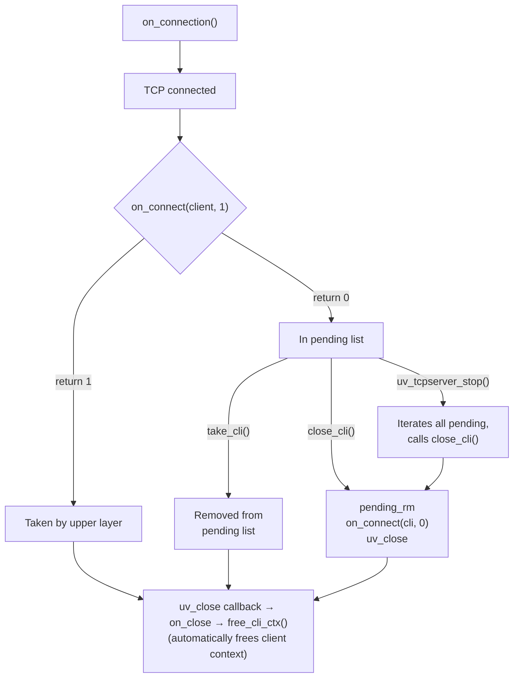

# libuvlib — libuv-based networking library

libuvlib is a lightweight, libuv-based TCP/HTTP networking library providing server and client abstractions for building IoT middleware and embedded-device communication systems.

## Modules

| Module         | Description                                                       |
| -------------- | ----------------------------------------------------------------- |
| `uv_tcpserver` | Multi-client TCP server with pending-list management              |
| `uv_tcpclient` | TCP client with auto-reconnect support                            |
| `uv_httpd`     | HTTP/1.1 server based on llhttp                                   |
| `uv_httpc`     | HTTP client with POST support                                     |
| `mybuf`        | Dynamic buffer with hexdump, printf, and reserve/append semantics |
| `uv_log`       | Thread-safe logging with level filtering                          |

## uv_tcpserver — Pending-List Architecture

### Overview

`uv_tcpserver` manages client connections through a **pending list** — a singly-linked list of clients that the upper layer has not yet "taken ownership" of. This design enables two-phase client lifecycle management:

1. **Phase 1 — Connection accepted**: The server accepts a TCP connection and calls `on_connect(client, 1)`. The return value determines what happens next.
2. **Phase 2 — Ownership decision**: The upper layer either takes ownership (return 1) or leaves the client in the pending list (return 0), and can later claim it via `uv_tcpserver_take_cli()`.

### Client Lifecycle States



### API Reference

#### Creation & Lifecycle

```c
int uv_tcpserver_create(uv_tcpserver_t** server, uv_loop_t* loop,
                         uv_tcpserver_settings_t* settings);
```

Create a new TCP server. `settings` must NOT be NULL.

```c
int uv_tcpserver_start_listen(uv_tcpserver_t* server,
                               const char* listen_addr, int listen_port);
```

Start listening on the given address and port.

```c
void uv_tcpserver_stop(uv_tcpserver_t* server);
```

Stop the server. Closes all pending clients first (each receives `on_connect(client, 0)`), then closes the listen socket. `on_server_shutdown` fires after the listen socket close completes.

```c
void uv_tcpserver_free(uv_tcpserver_t* server);
```

Free the server memory. **Must only be called after `uv_tcpserver_stop()` and after `on_server_shutdown` has fired.**

#### Client Management

```c
void uv_tcpserver_close_cli(uv_tcpserver_client_context_t* cli);
```

Close a specific client. Internally:

1. `pending_remove()` — removes from pending list if present
2. `on_connect(cli, 0)` — notifies upper layer of disconnect
3. `uv_close()` → `on_close` callback → `free_cli_ctx()` — frees client memory

```c
void uv_tcpserver_take_cli(uv_tcpserver_client_context_t* cli);
```

Upper layer takes ownership of a client. Removes it from the pending list. After this call, `uv_tcpserver_stop()` will NOT call `on_connect(cli, 0)` for this client.

```c
void uv_tcpserver_free_cli_ctx(uv_tcpserver_client_context_t* cli);
```

Free the client context memory. **Only call this from `on_connect(client, 0)` when the client was already disconnected and `uv_close` has completed.** In normal flow, `on_close` calls this automatically.

```c
int uv_tcpserver_send_to_cli(uv_tcpserver_client_context_t* cli,
                              const char* buf, size_t len);
```

Send data to a client.

### Callbacks

```c
typedef int (*uv_tcpserver_on_connection_t)(
    uv_tcpserver_client_context_t* client, int connected);
```

- `connected == 1`: A new client connected. Return values:
  - **Return 1**: Upper layer takes ownership. Client is NOT added to pending list.
  - **Return 0**: Client stays in pending list. Can be claimed later via `take_cli()`.
- `connected == 0`: Client disconnected (or is about to be closed). Return value is ignored. **Use this to clean up `client->data` only.**

```c
typedef uv_tcp_parse_result_t (*uv_tcpserver_on_parse_t)(
    uv_tcpserver_client_context_t* client,
    const char* buf, size_t len, size_t* ate);
```

Called when data arrives. Return `uv_tcp_parse_ok` and set `*ate` to bytes consumed. Return `uv_tcp_parse_not_enough` to wait for more data.

```c
typedef void (*uv_tcpserver_on_server_shutdown_t)(uv_tcpserver_t* server);
```

Called when the server listen socket has fully closed. Safe to call `uv_tcpserver_free()` after this.

---

## ⚠️ Critical Pitfalls

### 1. DO NOT call `uv_tcpserver_free_cli_ctx()` in `on_connect(client, 0)`

**WRONG:**

```c
int my_on_connect(uv_tcpserver_client_context_t* client, int connected) {
    if (connected) {
        return 0; // stay in pending list
    } else {
        uv_tcpserver_free_cli_ctx(client); // ❌ DOUBLE FREE!
        return 0;
    }
}
```

**Why it crashes:** When a client disconnects, the flow is:

```
on_read(nread < 0)
  → pending_remove()
  → on_connect(client, 0)    // your callback
  → uv_close(handle, on_close)
      → on_close()
          → uv_tcpserver_free_cli_ctx(client)  // library frees automatically!
```

If you call `free_cli_ctx` in `on_connect(client, 0)`, it will be freed **twice**.

**CORRECT:**

```c
int my_on_connect(uv_tcpserver_client_context_t* client, int connected) {
    if (connected) {
        return 0;
    } else {
        // Only clean up your own data, NOT the client context itself.
        // The library's on_close callback will call free_cli_ctx().
        if (client->data) {
            free(client->data);
            client->data = NULL;
        }
        return 0;
    }
}
```

### 2. DO NOT stop the client before stopping the server (when testing pending-list behavior)

When testing that `uv_tcpserver_stop()` closes pending clients, do NOT call `uv_tcpclient_stop()` first. Doing so triggers `on_read(nread < 0)` → `on_connect(client, 0)` → `uv_close`, and then `uv_tcpserver_stop()` will try to `uv_close` the already-closing handle → **double uv_close assertion failure**.

**WRONG:**

```c
// ❌ Client stop triggers uv_close first,
//    then server stop tries to uv_close again
uv_tcpclient_stop(client);
uv_tcpserver_stop(server);
```

**CORRECT:**

```c
// ✅ Let server stop handle all pending clients
uv_tcpserver_stop(server);
// Client will be closed as part of server stop
```

### 3. `on_connect` return type is `int`, not `void`

The callback signature changed from `void` to `int`. Returning `void` causes undefined behavior.

**WRONG:**

```c
static void my_on_connect(uv_tcpserver_client_context_t* client, int connected) {
    // ❌ Wrong return type
}
```

**CORRECT:**

```c
static int my_on_connect(uv_tcpserver_client_context_t* client, int connected) {
    if (connected) {
        return 0; // or return 1 to take ownership
    }
    return 0; // return value ignored when connected == 0
}
```

### 4. Client taken via `take_cli()` still gets `on_connect(client, 0)` on disconnect

When a client that was taken via `uv_tcpserver_take_cli()` later disconnects (peer closes, network error), the `on_read` error path will:

1. `pending_remove()` — no-op, already removed
2. `on_connect(client, 0)` — **will be called!**
3. `uv_close()` → `on_close` → `free_cli_ctx()`

So even for taken clients, your `on_connect(client, 0)` handler is called. This is the correct time to clean up your own `client->data`.

### 5. `uv_tcpserver_free()` must wait for `on_server_shutdown`

```c
// ❌ WRONG: server not fully shut down yet
uv_tcpserver_stop(server);
uv_tcpserver_free(server);

// ✅ CORRECT: wait for shutdown callback
uv_tcpserver_stop(server);
uv_run(loop, UV_RUN_DEFAULT); // or test_run_until(&done)
// on_server_shutdown fires here
uv_tcpserver_free(server);
```

---

## Complete Usage Example

### Simple Echo Server with Pending-List Management

```c
#include "libuvlib/libuvlib.h"

// --- Server callbacks ---

static int srv_on_connect(uv_tcpserver_client_context_t* client, int connected) {
    if (connected) {
        printf("Client connected, keeping in pending list\n");
        return 0; // stay in pending list
    } else {
        printf("Client disconnected\n");
        // Clean up your own data only
        if (client->data) {
            free(client->data);
            client->data = NULL;
        }
        return 0;
    }
}

static uv_tcp_parse_result_t srv_on_parse(
    uv_tcpserver_client_context_t* client,
    const char* buf, size_t len, size_t* ate) {
    // Echo back
    uv_tcpserver_send_to_cli(client, buf, len);
    *ate = len;
    return uv_tcp_parse_ok;
}

static void srv_on_shutdown(uv_tcpserver_t* server) {
    printf("Server shut down\n");
}

// --- Main ---

int main() {
    uv_loop_t loop;
    uv_loop_init(&loop);

    uv_tcpserver_settings_t settings = {
        .on_connect         = srv_on_connect,
        .on_parse           = srv_on_parse,
        .on_server_shutdown = srv_on_shutdown,
    };

    uv_tcpserver_t* server = NULL;
    uv_tcpserver_create(&server, &loop, &settings);
    uv_tcpserver_start_listen(server, "0.0.0.0", 8080);

    printf("Server listening on port 8080\n");
    uv_run(&loop, UV_RUN_DEFAULT);

    uv_tcpserver_stop(server);
    uv_run(&loop, UV_RUN_DEFAULT); // wait for shutdown
    uv_tcpserver_free(server);
    uv_loop_close(&loop);
    return 0;
}
```

### Server with `take_cli` — Taking Ownership

```c
static uv_tcpserver_client_context_t* g_auth_client = NULL;

static int srv_on_connect(uv_tcpserver_client_context_t* client, int connected) {
    if (connected) {
        // Keep in pending list initially
        return 0;
    } else {
        // Clean up your own data
        return 0;
    }
}

static uv_tcp_parse_result_t srv_on_parse(
    uv_tcpserver_client_context_t* client,
    const char* buf, size_t len, size_t* ate) {
    // Check for auth message
    if (len >= 4 && memcmp(buf, "AUTH", 4) == 0) {
        // Take ownership — remove from pending list
        uv_tcpserver_take_cli(client);
        g_auth_client = client;
        uv_tcpserver_send_to_cli(client, "OK", 2);
    }
    *ate = len;
    return uv_tcp_parse_ok;
}
```

### Server with `on_connect` returning 1 — Immediate Ownership

```c
static int srv_on_connect(uv_tcpserver_client_context_t* client, int connected) {
    if (connected) {
        // Take ownership immediately — NOT added to pending list
        client->data = my_create_session();
        return 1;
    } else {
        // Clean up your own session
        if (client->data) {
            my_destroy_session(client->data);
            client->data = NULL;
        }
        return 0;
    }
}
```

---

## Build & Test

### Windows (Visual Studio 2019+)

Open `vsprojects/libuvlib.sln`, build the `uvlib_test` project.

### Linux

```bash
cd vsprojects/test/uvlib_test
make
make test
```

---

## Changelog

See [CHANGELOG.md](CHANGELOG.md) for version history.
